<p align="center">
  <a href="https://gifsuite.com"></a>
</p>

<h1 align="center">GifSuite</h1>

<p align="center">
  <strong>Grab, convert and make GIFs. Free, in your browser.</strong><br>
  <a href="https://gifsuite.com"><strong>gifsuite.com</strong></a> ·
  <a href="https://gifsuite.com/tools">All tools</a> ·
  <a href="https://gifsuite.com/blog">Blog</a>
</p>

<p align="center">
  <a href="LICENSE"></a>
  
  
  
</p>

<p align="center">
  <a href="https://gifsuite.com">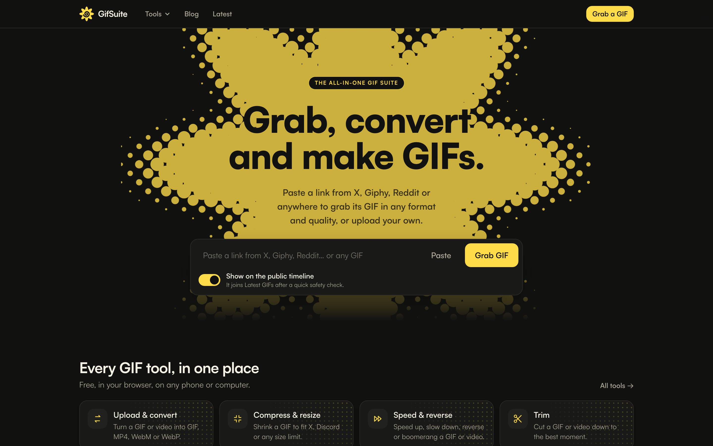</a>
</p>

GifSuite is a free GIF toolkit. Paste a link from X (Twitter), Giphy, Tenor, Reddit, Imgur or almost any site and get its GIF in GIF, MP4, WebM or WebP, in low, medium or high quality. You can also post it back to X as a real GIF. It also has upload tools to convert, compress, resize, trim, crop, speed up or reverse a GIF, add meme text, or turn pictures into a GIF. Nothing to install and no account needed.

**Try it live at [gifsuite.com](https://gifsuite.com).**

## Features

- **Grab from any link.** Paste an X post, Giphy, Tenor, Reddit, Imgur or a direct file and get the GIF. X GIFs come through X's public embed endpoint, with yt-dlp as a fallback for everything else.
- **Every format and quality.** Download as GIF, MP4, WebM or WebP at 320px, 480px or up to 1080px wide. Each version is made on first request and cached.
- **Post back to X.** Share to X so the post plays the original GIF, credited to its author. Nothing to re-upload.
- **Upload tools.** Convert, compress to a size limit (for X, Discord and others), resize, trim, crop, change speed, reverse or boomerang, add top and bottom text, and make a GIF from one or more pictures with zoom, pan, pulse or shake.
- **Public timeline.** Grabbed GIFs can appear on a public "Latest" feed. Whoever grabbed a GIF can make it private at any time.
- **Safety built in.** An open-source NSFW model (nsfwjs) checks GIFs before they reach the timeline, and nothing leaves the system for that check. Reports auto-hide GIFs after enough distinct reporters, and copyright takedowns are supported.
- **Private by design.** No accounts and no stored IP addresses. Analytics count unique visitors with a salted hash. Files uploaded to the tools are processed and never stored.
- **Bot protection.** Invisible Cloudflare Turnstile checks, rate limits, and a circuit breaker that pauses calls to X when X is failing.
- **Fast everywhere.** Runs on Cloudflare's edge, with server-rendered pages, link previews and a sitemap for search.
- **Native iOS app.** A SwiftUI app shares the same API (work in progress, see [`ios_app/`](ios_app/)).

## Screenshots

| Grab any GIF, then download or share it | Every tool in one place |
| --- | --- |
| [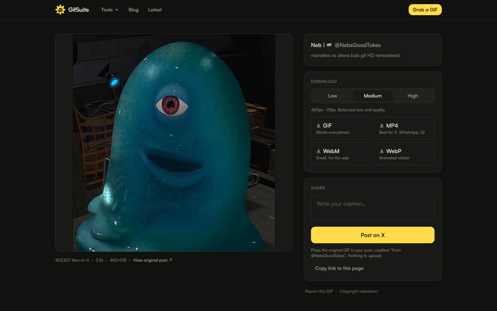](https://gifsuite.com) | [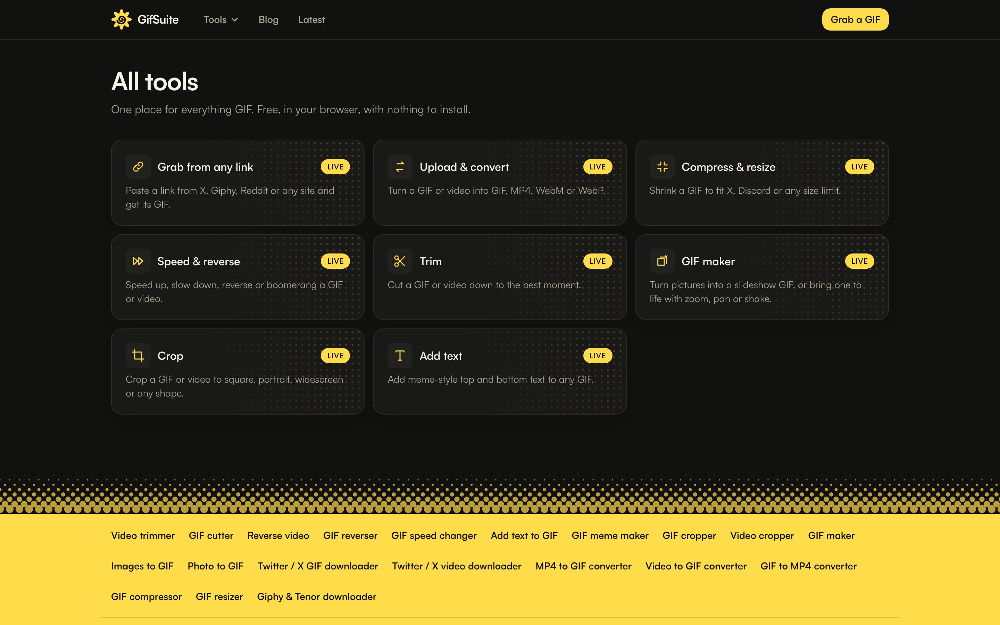](https://gifsuite.com/tools) |
| **GIF maker:** pictures to a GIF, with effects | **Compress and resize** to fit any size limit |
| [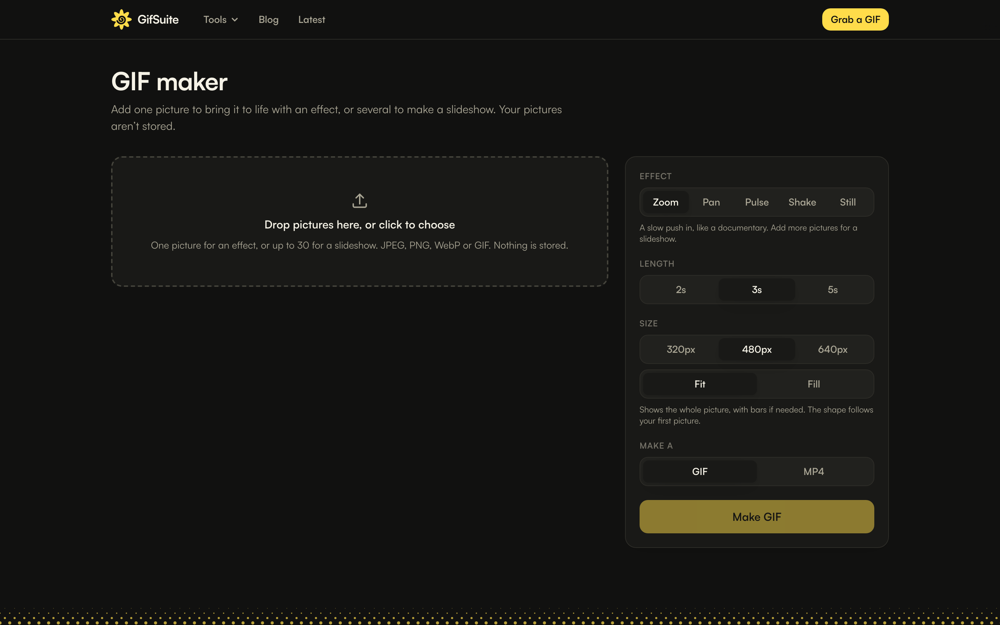](https://gifsuite.com/tools/maker) | [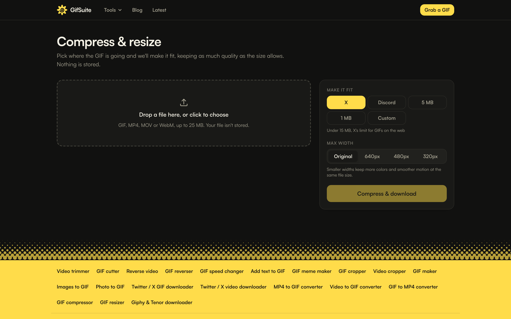](https://gifsuite.com/tools/compress) |
| **Add text:** meme-style captions | **Blog** |
| [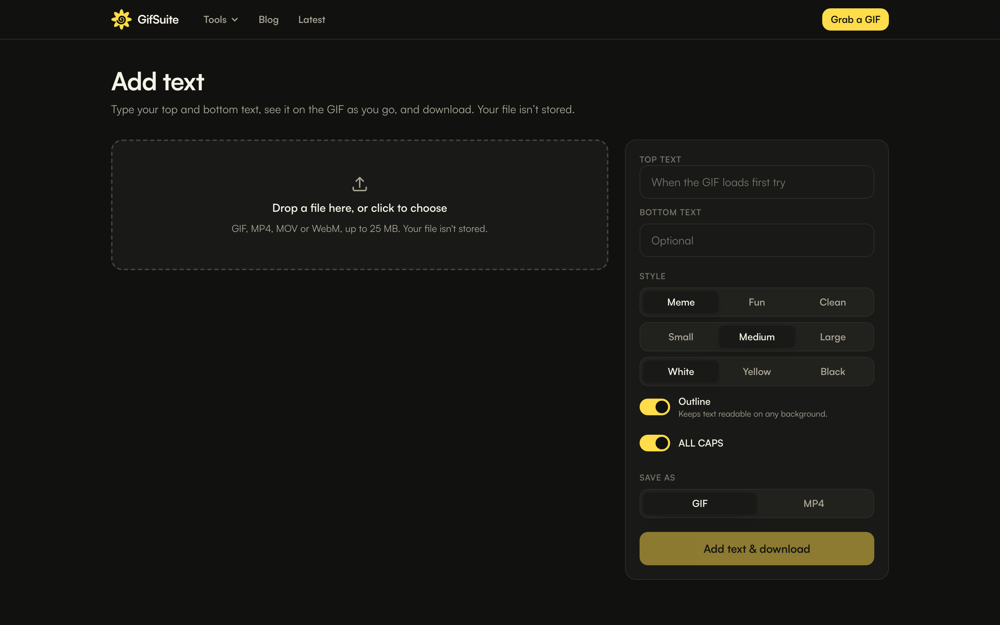](https://gifsuite.com/tools/captions) | [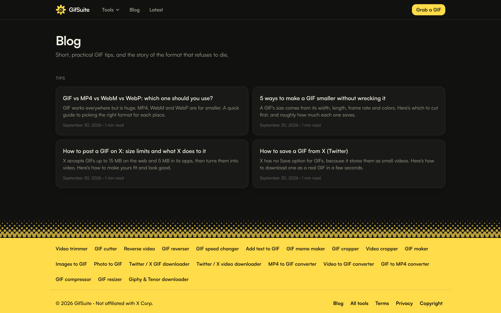](https://gifsuite.com/blog) |

### On your phone

| Mobile web | GIF page on mobile | iOS app: Grab | iOS app: Timeline | iOS app: Tools |
| --- | --- | --- | --- | --- |
| 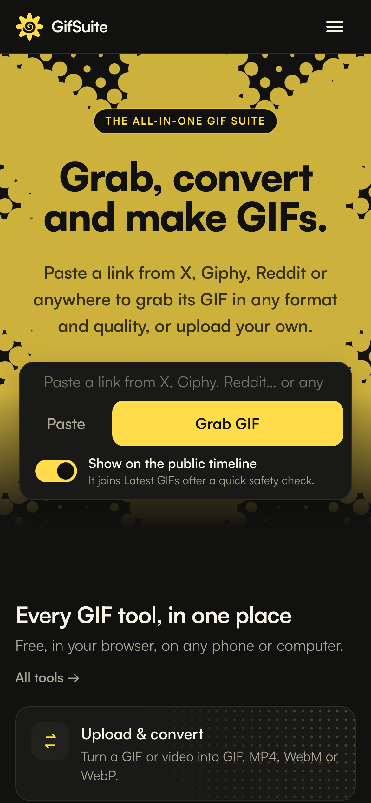 | 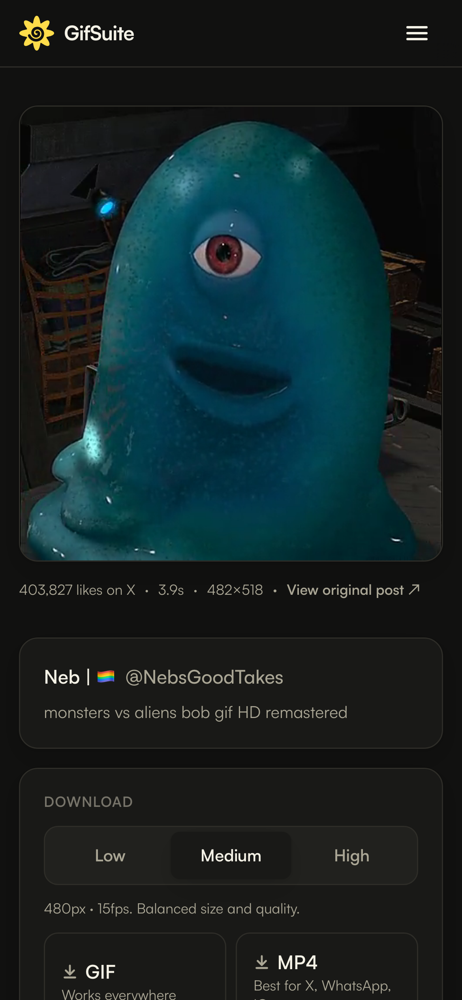 | 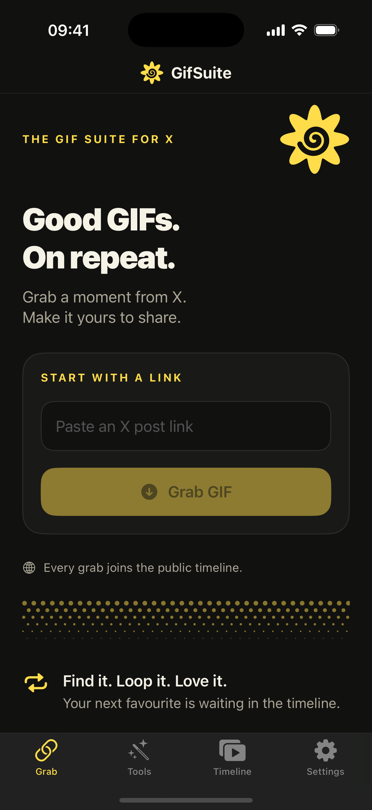 | 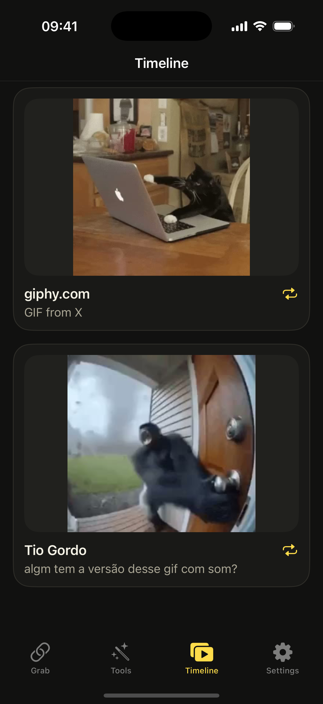 | 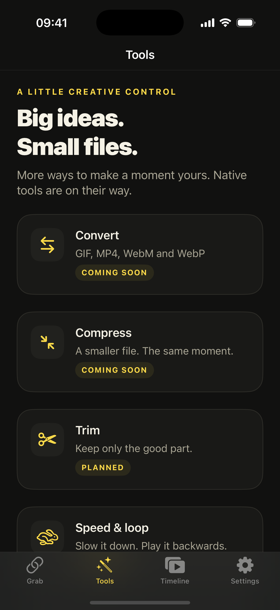 |

## Tech stack

| Layer | What |
| --- | --- |
| Web app | [Next.js](https://nextjs.org) 16 (App Router), React 19 and Tailwind CSS 4 |
| Hosting | [Cloudflare Workers](https://workers.cloudflare.com) via [OpenNext](https://opennext.js.org/cloudflare) |
| Database | Cloudflare D1 (SQLite) |
| File storage | Cloudflare R2 |
| Media processing | A Cloudflare Container running Node with ffmpeg, gif2webp, yt-dlp and nsfwjs |
| Analytics | Workers Analytics Engine and Cloudflare Web Analytics |
| iOS | SwiftUI (iOS 17+), project generated by XcodeGen |
| Tests | Vitest and Playwright (API and end-to-end) |

## Project layout

```text
app/          Next.js routes: pages, tools, blog and the /api endpoints
components/   React UI (tools, shell, marketing pages, design system)
lib/          Server logic: grabbing, links, media conversion, moderation, analytics
db/           D1 queries
migrations/   D1 schema migrations
processor/    The media processor (ffmpeg, yt-dlp, NSFW model); a Container in production
content/      Blog posts in Markdown
ios_app/      Native SwiftUI app, with its feature plan and backlog
tests/        Unit, API and end-to-end tests, plus a fake X server for offline testing
worker.ts     Cloudflare Worker entry: redirects, cron jobs and the Container
```

## Run it on your Mac

```bash
brew install ffmpeg webp yt-dlp   # used by the media processor
npm install
npm install --prefix processor     # the processor's NSFW model (nsfwjs + TensorFlow.js)
npm run dev                       # http://localhost:3217
```

`npm run dev` applies database migrations to a **local** D1, then starts the media processor (`processor/server.mjs`, port 3297) and the Next.js dev server together. Local D1 and R2 data live in `.wrangler/` (git-ignored). Nothing touches your Cloudflare account.

The old `./data` folder from the pre-Cloudflare version is no longer used and can be deleted.

## Settings

Plain settings live in `wrangler.jsonc` under `vars`, per environment (`dev`, `test`, `staging`, production). Secrets are never in files; they're set with `wrangler secret put NAME`.

| Setting | Kind | Purpose |
| --- | --- | --- |
| `PUBLIC_BASE_URL` | var | Absolute site URL for link previews |
| `ADMIN_TOKEN` | **secret** (24+ chars) | Enables `POST /api/admin/hide`, `/api/admin/nsfw` and `/api/admin/scan-pending` (header `x-admin-token`). The NSFW retry sweep uses it, so set it in every deployed environment. |
| `CF_WEB_ANALYTICS_TOKEN` | var (public, not secret) | Cloudflare Web Analytics site token for page views; the beacon is left out when unset. See DEPLOY.md. |
| `TURNSTILE_SITE_KEY` | var (public) | Cloudflare Turnstile site key; turns on the invisible human check in the browser. See DEPLOY.md. |
| `TURNSTILE_SECRET` | **secret** | Turnstile secret; when set, grab, upload and edit requests must carry a valid token. Off when unset. |
| `X_BREAKER_FAILURES` | var | X failures within 2 minutes that pause X for a minute (default 5; tests use 1000). |
| `NSFW_THRESHOLD` | var | Explicit-content score (0–1) at which a scanned GIF is flagged sensitive (default 0.6) |
| `VISITOR_SALT` | **secret** | Used to count unique visitors without storing IPs |
| `AUTO_HIDE_REPORTS` | var | Distinct reporters before a GIF is hidden (default 5) |
| `MAX_SOURCE_MB` / `MAX_DURATION_S` | var | Limits on grabbed videos (default 50 / 60); the duration limit also applies to uploads |
| `MAX_UPLOAD_MB` | var | Largest file the upload tools accept (default 25) |
| `ALLOW_INDEXING` | var, production only | `1` lets search engines index the site. Anything else sends `noindex` and a disallow-all robots.txt. |
| `PROCESSOR_URL` | var, dev/test only | Where the local media processor listens. In production the Container is used instead. |

## How it works

| Part | File | What it does |
|---|---|---|
| X fetcher | `lib/x/fetchTweetMedia.ts` | Resolves a post link to its MP4 through X's public embed endpoint, falling back to yt-dlp in the processor |
| Any-link fetcher | `lib/links.ts`, `processor/fetch.mjs` | Every non-X link. The processor downloads a direct GIF/MP4/WebM file, or the media a page advertises in its link-preview tags (Giphy, Tenor, Imgur…), or falls back to yt-dlp for everything else; then normalises it to H.264 MP4. Refuses private and internal addresses (every hostname and redirect is checked). De-duplicated by a hash of the normalised link (tracking parameters removed). A site's 18+ label flags the GIF at once. |
| Grab pipeline | `lib/ingest.ts` | Downloads the MP4, has the processor probe it and make the poster and timeline preview, stores everything in R2, and saves the D1 row. Deduplicated per post and media slot. The NSFW check runs afterwards (see below), so grabbing never waits for it. |
| Analytics | `lib/analytics.ts`, `lib/analytics-core.ts`, `worker.ts`, `components/shell/ClientEvents.tsx` | Every server event (grab with the pasted link's site, view, share, report, download, convert, compress, visibility, NSFW check, admin actions, errors), every page view (with where the visit came from and which crawler), and browser-only events (file kinds picked, files turned away, error messages shown, JavaScript crashes) go to Workers Analytics Engine with status, timing, sizes, country and device; no IPs, links or file names. `npm run analytics` summarises it. |
| Visibility | `lib/owner.ts`, `app/api/gif/[id]/visibility/route.ts` | GIFs are public by default. The browser that grabbed a GIF gets an owner key (HttpOnly `gs_owner` cookie; only its SHA-256 is stored) and can take the GIF off the timeline or put it back. Private GIFs keep working by link but are `noindex`. |
| NSFW filter | `lib/moderation.ts`, `lib/nsfw.ts`, `processor/nsfw.mjs` | Gates the public timeline only; grabbing, downloading and sharing never wait for it. X's "possibly sensitive" mark is applied at grab time. Otherwise a public GIF starts unchecked (off the timeline) and is scanned after the response by the open-source nsfwjs model, 6 frames in the processor (about 0.4s; nothing leaves our system). A private GIF is scanned when it's made public. A cron trigger (every 5 minutes, `worker.ts` → `POST /api/admin/scan-pending`) retries unfinished checks. Sensitive GIFs never appear on the timeline, have no link preview, and are blurred behind "Show anyway". |
| Converter | `lib/media/convert.ts` | Makes each format and quality on first request and keeps it in R2 |
| Upload & convert | `app/api/convert/route.ts` | Converts an uploaded file and returns it. Checks the type from the file's bytes (`lib/media/sniff.ts`); nothing is stored. |
| Compress & resize | `app/api/compress/route.ts` | Shrinks an upload into a GIF under a target size. The processor tries smaller settings until it fits (`nextAttempt` / `growAttempt` in `processor/presets.mjs`). |
| Blog | `content/blog/*.md` → `scripts/build-content.mjs` | Markdown posts are validated and compiled at build time into `lib/blog/posts.generated.json`. How posts get written: `content/BLOG_PLAYBOOK.md`. |
| Media processor | `processor/` | The only place ffmpeg, gif2webp and yt-dlp run. A Cloudflare Container in production, a plain Node process locally. Presets are in `processor/presets.mjs`. |
| Events | `events` table | Records grabs, views, downloads, shares and reports, which will feed the Trending page |

## Tests

See `TESTING.md`. In short, run `npm run check` before every commit and `npm run check:all` for everything.

## Deploying your own

Everything runs on one Cloudflare account: a D1 database, an R2 bucket and a Container. Secrets are set with `wrangler secret put`, and `DEPLOY.md` covers bot protection, analytics and the first production deploy. The GitHub Actions workflow tests every push, deploys `main` to staging, and deploys to production when you choose. In `wrangler.jsonc`, replace the database IDs, routes and `PUBLIC_BASE_URL` with your own, and set `CLOUDFLARE_ACCOUNT_ID` in `.github/workflows/deploy.yml`.

## Contributing

Issues and pull requests are welcome. Before opening a PR:

1. Run `npm install` to install the pre-commit hook, which blocks secrets from being committed.
2. Run `npm run check`, which runs the secret scan, typecheck, lint, unit tests and API tests.
3. For UI changes, also run `npm run test:e2e`.

## License

[MIT](LICENSE) © 2026 dominusmaster. GifSuite is not affiliated with X, Giphy, Tenor or Reddit. Grabbed GIFs belong to their creators. See the [copyright policy](https://gifsuite.com/copyright) for takedowns.
